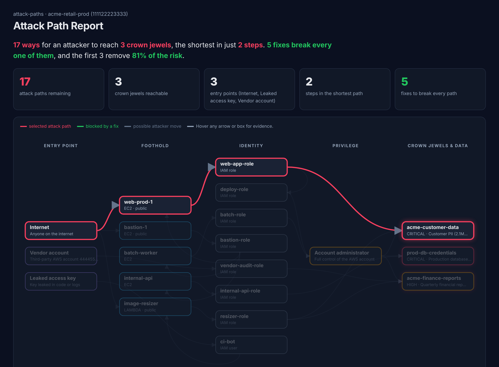
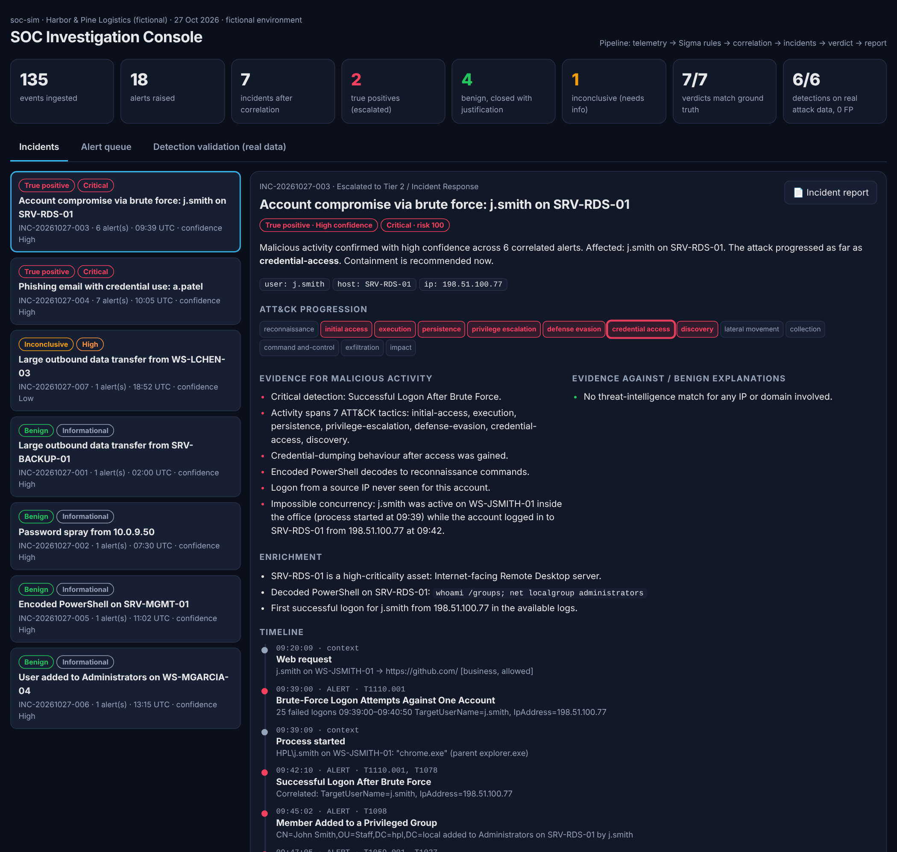

# Cybersecurity Portfolio

Welcome to my cybersecurity portfolio. This repository documents practical, authorized security projects built to develop skills across enterprise infrastructure, security monitoring, detection engineering, and adversary-informed testing.

My work is evidence-driven: each completed project includes the lab design, implementation process, validation steps, technical findings, screenshots, and lessons learned.

## Completed Projects

### [Project 01 — Enterprise Active Directory Detection Lab](project-01-enterprise-ad-detection-lab/)

> **Status:** Complete

An isolated enterprise-style lab that connects Windows domain administration, centralized security telemetry, controlled testing, and detection engineering.

The environment includes:

- A Windows Server domain controller running Active Directory Domain Services and DNS
- A domain-joined Windows workstation
- A Kali Linux system for authorized security validation
- A Splunk Enterprise server for centralized monitoring and alerting
- Splunk Universal Forwarder and Sysmon telemetry

The project validates the complete defensive workflow:

```text
Configure telemetry → Generate controlled activity → Investigate events → Build detections → Create dashboards and alerts → Document results
```

### Key Results

- Deployed the `corp.local` Active Directory domain and joined a Windows workstation
- Validated domain authentication and account-lockout controls
- Investigated Windows Security Event ID `4740`
- Performed authorized Nmap reconnaissance and confirmed SMB signing was required
- Centralized Windows Security, System, Application, and Sysmon logs in Splunk
- Built and tested detections for failed authentication, PowerShell execution, account changes, service installation, and scheduled-task activity
- Created a security-monitoring dashboard and enabled scheduled alerts
- Documented false positives, investigation guidance, limitations, and supporting evidence

[View the complete project documentation and evidence →](project-01-enterprise-ad-detection-lab/)

### [Project 02 — Phishing Email Analyzer](project-02-phishing-email-analyzer/)

> **Status:** Complete

An offline Python tool that triages suspicious `.eml` files and produces an analyst-style report with a verdict, a 0–100 risk score and recommended actions. It never opens links or runs attachments, so it is safe to use on live samples.

### Key Results

- Parses SPF, DKIM and DMARC results and flags spoofed senders, Reply-To mismatches and display-name impersonation
- Detects look-alike domains (typosquats, brand keywords, punycode), link-text/destination mismatches, raw-IP links and URL shorteners
- Flags dangerous attachments (double extensions, executables, macro-enabled Office files) and records SHA-256 hashes for threat-intel lookups
- Identifies business email compromise patterns such as gift-card and secrecy requests from free webmail
- Correctly classified all 4 fabricated test samples, including a BEC email that passed SPF, DKIM and DMARC
- Unit tests run automatically in GitHub Actions on every change

[View the project code and documentation →](project-02-phishing-email-analyzer/)

### [Project 03 — Threat Intel IOC Extractor](project-03-ioc-extractor/)

> **Status:** Complete

A command-line tool that turns unstructured threat-intelligence reports into clean, de-duplicated indicators of compromise and exports them for security tools, including as a STIX 2.1 bundle for threat-intel platforms.

### Key Results

- Refangs common obfuscation styles (`hxxp`, `[.]`, `(.)`, `[dot]`, `[at]`) before extraction
- Extracts 10 indicator types: IPv4, IPv6, domains, URLs, email addresses, MD5/SHA-1/SHA-256 hashes, CVEs and MITRE ATT&CK technique IDs
- Filters noise such as private IPs, benign reference domains, file names that look like domains, and version strings that look like IPs
- Exports to text, JSON, CSV, defanged Markdown and STIX 2.1 (indicators, vulnerabilities and attack patterns, with deterministic IDs)
- Extracted all 26 planted indicators from a fictional threat brief while ignoring all 10 planted noise values
- Builds on the threat-indicator backend I developed for the ThreatLens capstone project

[View the project code and documentation →](project-03-ioc-extractor/)

### [Project 04 — AWS IAM Policy Risk Analyzer](project-04-iam-policy-analyzer/)

> **Status:** Complete

An offline analyzer for AWS IAM policies and full account exports that finds who can become an administrator, even if they are not one today.

### Key Results

- Evaluates each user and role with all its permissions combined: inline, attached managed and group-inherited policies
- Detects 21 known privilege-escalation paths, such as `iam:PassRole` + `ec2:RunInstances` and `iam:CreatePolicyVersion`
- Handles AWS wildcard matching, `NotAction`/`NotResource` and explicit denies, and rates scoped permissions lower than account-wide ones
- Flags wildcard and `NotAction` grants, public resource policies, risky trust policies and permissions that can disable CloudTrail or GuardDuty
- On a fictional 9-principal account: 1 administrator on paper, but 3 more principals that can escalate to admin
- Outputs SARIF for GitHub code scanning and a `--fail-on` CI gate

[View the project code and documentation →](project-04-iam-policy-analyzer/)

### [Project 05 — Risk-Based Vulnerability Prioritizer](project-05-vuln-prioritizer/)

> **Status:** Complete

A dependency scanner that ranks vulnerabilities by real-world exploitation risk, not severity alone, by combining OSV.dev, the CISA Known Exploited Vulnerabilities catalog and FIRST EPSS scores.

### Key Results

- Scans Python `requirements.txt` and npm `package-lock.json` (v1–v3, including nested dependencies)
- Live scan of 11 outdated Python packages: 177 vulnerabilities, 99 rated High/Critical, but only 12 needing immediate action (88% less urgent work)
- Ranked a CISA KEV-listed Pillow vulnerability (CVE-2023-4863, CVSS 8.8) above 19 Critical-rated (CVSS 9+) findings in the same scan
- Produces an upgrade plan with the smallest version that fixes each package's known issues
- Built-in CVSS v3 calculator verified against reference vectors; offline unit tests use an injected fake network layer
- Weekly scheduled live scan in GitHub Actions

[View the project code and documentation →](project-05-vuln-prioritizer/)

### [Project 06 — Cloud Attack Path Analyzer](project-06-attack-path-analyzer/)

> **Status:** Complete

Builds a graph of a cloud environment and finds how an attacker could chain small weaknesses into a breach: every path from an entry point to sensitive data, ranked by risk, plus the smallest set of fixes that breaks them all. Brings Projects 04 and 05 together.



### Key Results

- Models internet exposure, exploitable vulnerabilities (CISA KEV / EPSS / CVSS), IAM roles and trust policies, lateral movement (SSM, Lambda), privilege escalation and data access as one graph, with a MITRE ATT&CK technique on every step
- On a fictional AWS environment with real vulnerability data: 17 attack paths to 3 crown jewels, the most dangerous only 3 steps from the internet to customer PII
- Greedy choke-point analysis found 5 fixes that break all 17 paths, with the first 3 removing 81% of the risk
- Surfaced issues a finding-by-finding scan misses, such as an `acme-*` wildcard that gave an image-processing Lambda access to customer data, and a bastion host on 8 paths despite having no exploitable CVE
- Self-contained interactive HTML report: trace any path, hover for evidence, and tick fixes to watch paths close
- 14 unit tests and a `--fail-on-paths` CI gate

[View the project code, interactive report and documentation →](project-06-attack-path-analyzer/)

### [Project 07 — SOC Investigation & Response Simulator](project-07-soc-investigation-simulator/)

> **Status:** Complete

A miniature SOC that takes raw telemetry all the way to an incident report: Sigma detection rules, Sigma correlation rules, entity-based incident grouping, context checks, an honest verdict and a report for Tier 2. Tested on real attack telemetry as well as a labelled scenario day.



### Key Results

- Validated on 3,504 real Windows events from OTRF Security-Datasets: 6/6 expected detections, 0 false positives, 0 missed
- Tuned a Run-key persistence rule that produced 4 false positives on real data (`lsass.exe` writing `...\RunTime` registry values) down to 0
- Found and handled a real data-quality issue: Sysmon timestamps 16 hours off the record time, fixed by de-duplicating Sysmon 1 / Security 4688 on process ID
- Scenario day: 18 alerts correlated into 7 incidents with 7/7 correct verdicts (2 true positives, 4 benign false-positive traps closed with justification, 1 honestly inconclusive)
- Evidence-based triage: change-ticket and allowlist matching, threat-intel enrichment, decoded PowerShell, "impossible concurrency" detection, phishing scope analysis
- Interactive analyst console, Markdown incident reports, 21 unit tests and a CI gate on verdict and detection accuracy

[View the project code, analyst console and incident reports →](project-07-soc-investigation-simulator/)

## Skills Demonstrated

- Active Directory Domain Services and DNS administration
- Windows domain enrollment and identity management
- Windows Security event analysis and audit-policy configuration
- Sysmon deployment and troubleshooting
- Splunk Enterprise and Universal Forwarder configuration
- SPL search development and XML event-field extraction
- Detection engineering, dashboards, reports, and scheduled alerts
- PowerShell administration
- Authorized Nmap reconnaissance and SMB security validation
- False-positive analysis and investigation planning
- Security evidence collection and technical documentation
- Email security analysis (SPF, DKIM, DMARC, phishing and BEC indicators)
- Python security tooling, unit testing and GitHub Actions CI
- Threat intelligence: IOC extraction, refanging and STIX 2.1
- Cloud security: AWS IAM policy evaluation and privilege-escalation analysis
- Vulnerability management: risk-based prioritization with CVSS, EPSS and CISA KEV
- Attack path analysis: graph modelling, choke-point remediation planning and MITRE ATT&CK mapping
- SOC triage and incident response: Sigma and Sigma correlation rules, alert correlation, verdicts with confidence, incident reporting

## Portfolio Direction

This portfolio is developing toward authorized offensive security and red teaming while maintaining strong defensive visibility. Future work will build on the enterprise foundation established in Project 01 through web and API security testing, Active Directory attack-path analysis, vulnerability research, and full-scope adversary simulation.

Future projects will be added here only after implementation and validation are complete.

## Portfolio Principles

- Publish evidence, not unsupported claims
- Use only owned or explicitly authorized systems
- Keep testing isolated, safe, and reversible
- Remove credentials, secrets, and sensitive information
- Document failures, limitations, and false positives honestly
- Make every project reproducible and technically defensible

## About Me

I am a cybersecurity student building hands-on capability in authorized offensive security, Active Directory, Windows security telemetry, Splunk, Sysmon, detection engineering, PowerShell, and security investigation.

This portfolio records my progress through completed, evidence-backed projects rather than unverified claims or unfinished demonstrations.

## Ethical Use

All security testing documented in this portfolio is performed only in isolated lab environments or on systems for which explicit authorization has been granted.
