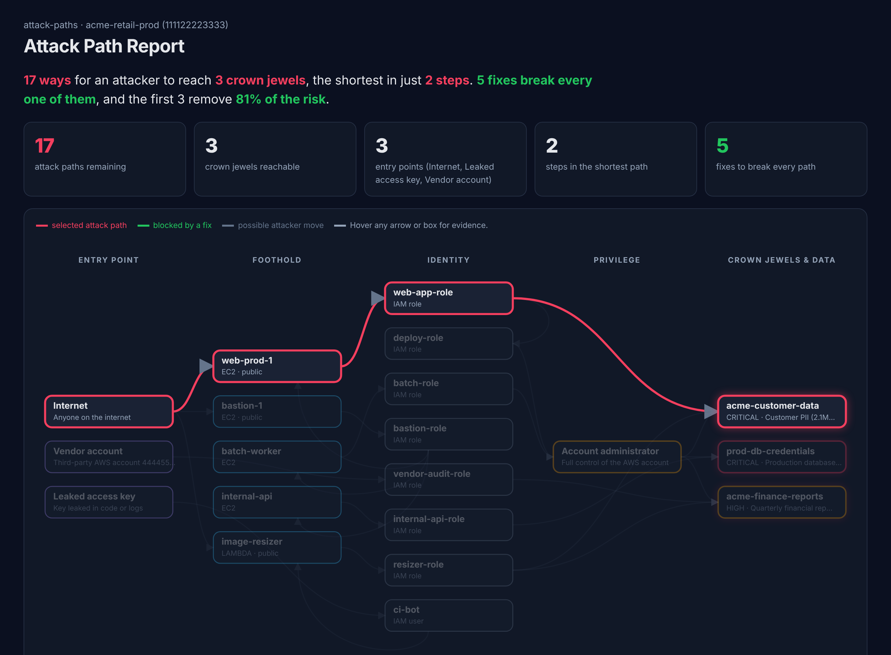

# Project 06 — Cloud Attack Path Analyzer (attack-paths)

**Attackers think in graphs. Most security tools still produce lists.**

A typical cloud security report says: *"web-prod-1 has a vulnerable package"*,
*"deploy-role can pass roles"*, *"a vendor role has no ExternalId"*. Each
finding looks like a medium-priority ticket. None of them says the thing that
matters: **an attacker on the internet can reach your customer database in
three moves.**

attack-paths builds a graph of a cloud environment (internet exposure,
vulnerable software, IAM roles and trust relationships, lateral movement and
sensitive data), then:

1. finds **every attack path** from an entry point to a crown jewel,
2. ranks them by **risk** (impact × how easy each step is),
3. calculates the **smallest set of fixes that breaks every path**, and
4. produces an **interactive report** where you can tick fixes and watch the paths close.

It's the same idea behind the attack-path and "toxic combination" features
of commercial cloud security platforms (CNAPPs), written from scratch in
about 700 lines of standard-library Python.



## Results on the sample environment

`samples/acme_environment.json` is a **fictional** retail company's AWS
account: 6 compute resources, 8 roles, 2 users and 4 data stores. Its
vulnerability data (CVE, CVSS, EPSS and CISA KEV status) is **real**, taken
from [Project 05](../project-05-vuln-prioritizer/)'s live scan.

| | |
|---|---|
| Attack paths to crown jewels | **17** |
| Crown jewels reachable | **3 of 3** (customer PII, production DB credentials, financial reports) |
| Entry points | Internet, a leaked access key, a vendor's AWS account |
| Shortest path | **2 steps** (vendor account → over-trusting role → financial reports) |
| Most dangerous path | **3 steps**: Internet → exploit CVE-2023-4863 (CISA KEV) on `web-prod-1` → steal its role's credentials → read customer PII |
| **Fixes to break every path** | **5** (the first 3 remove **81%** of the risk) |

The fix plan, in order:

| # | Fix | Paths broken | Risk removed (cumulative) |
|---|---|---|---|
| 1 | Upgrade django and pillow on `web-prod-1` (2 exploitable CVEs), or remove its internet exposure | 4 | 38% |
| 2 | Upgrade pillow on the public `image-resizer` Lambda | 2 | 61% |
| 3 | Close SSH (port 22) to the internet on `bastion-1` | 8 | 81% |
| 4 | Remove `ci-bot`'s 412-day-old access key | 2 | 93% |
| 5 | Add an `ExternalId` condition to the vendor role's trust policy | 1 | 100% |

Things a finding-by-finding scan would miss:

- **`resizer-role` was meant for product images**, but its policy says
  `arn:aws:s3:::acme-*/*`. That wildcard also matches `acme-customer-data`
  and `acme-finance-reports`, so a public image-resizing Lambda is 3 steps
  from customer PII.
- **`bastion-1` has no exploitable CVE**, but its SSH password login leads to
  `bastion-role`, which can run commands on any instance through SSM. That
  makes one weak bastion a hub for 8 paths, and closing it is the biggest
  single path reduction.
- **`alice` is a full administrator**, but has MFA and no access keys, so she
  is not on any path. Admin rights alone don't make a path; reachability does.

## How it works

```
inventory.json ─► build graph ─► find paths ─► plan fixes ─► text / Markdown / JSON / interactive HTML
```

**Nodes**: entry points, compute (EC2, Lambda), identities (roles, users),
account admin, and data stores (S3, Secrets Manager, DynamoDB) labelled by sensitivity.

**Edges** are attacker moves. Each has a MITRE ATT&CK technique, an effort
score (1 = trivial … 6 = hard), the evidence behind it, and a fix:

| Move | ATT&CK | When the tool adds it |
|---|---|---|
| Exploit a public service | T1190 | Port open to `0.0.0.0/0` **and** the software has a CVE that is in CISA KEV (effort 1), has EPSS ≥ 10% (2), or CVSS ≥ 9 (4) |
| Brute-force SSH/RDP | T1110 | Admin port open to the internet with password login (6) |
| Use the attached role's credentials | T1552.005 | The compute resource runs with an IAM role |
| Assume another role | T1078.004 | The principal **has** `sts:AssumeRole` **and** the target's trust policy allows it |
| Trusted vendor relationship | T1199 | A role trusts a whole external account without `ExternalId` (4) |
| Use a leaked long-lived key | T1078.004 | Access key older than 90 days and no MFA (5) |
| Run commands through SSM | T1651 | `ssm:SendCommand` on an instance |
| Replace Lambda code | T1648 | `lambda:UpdateFunctionCode` on a function |
| Escalate to admin | T1098 | One of 8 privilege-escalation paths from [Project 04](../project-04-iam-policy-analyzer/), on all resources |
| Read sensitive data | T1530 | Read permission on the data store, **including a single prefix** of a bucket |

**Paths**: depth-first search for every simple path (no loops) from each
entry point to each crown jewel (critical or high sensitivity).
Risk = impact × ease, 0–100.

**Fix plan**: a greedy **choke-point** algorithm. It repeatedly picks the
fixable step that sits on the most remaining risk, removes the paths it
breaks, and repeats until none are left. On a tie, it cuts the step closest
to the entry point. Finding the absolute minimum set is a minimum-cut/hitting-set
problem; greedy is the standard practical approximation and gives a ranked list
a team can work through.

## The interactive report

`output/attack_path_report.html` is a single file with no external scripts
or network requests, so it can be attached to a ticket or opened offline.

- **Attack map**: five columns (Entry → Foothold → Identity → Privilege → Crown jewels). Lateral movement shows as arcs back to the foothold column.
- **Click any path** to trace it in red, with each step's ATT&CK technique.
- **Hover any arrow** to see the evidence and the fix.
- **Tick fixes** to simulate them: blocked moves turn green, broken paths are struck through, crown jewels turn green when nothing reaches them, and a meter shows the risk removed.
- Light and dark themes.

## Quick start

```bash
python3 attack_paths.py samples/acme_environment.json                     # text summary
python3 attack_paths.py samples/acme_environment.json --html report.html  # interactive report
python3 attack_paths.py samples/acme_environment.json --format markdown -o report.md
python3 attack_paths.py samples/acme_environment.json --format json -o paths.json
python3 attack_paths.py env.json --fail-on-paths                          # CI gate
python3 -m unittest discover -s tests -v                                  # 14 tests
```

## Limitations and next steps

- **Inventory is a hand-written JSON format.** The next step is a collector
  that builds it read-only from AWS APIs (EC2, IAM, Lambda, S3) plus a
  software inventory (SBOM or SSM Inventory), feeding Projects 04 and 05 in directly.
- Network reachability is modelled as "public or not". VPC routing, NACLs and
  security-group-to-security-group rules would make internal lateral movement more precise.
- IAM conditions, SCPs and permission boundaries are not evaluated, so some
  paths may be blocked in reality. The tool errs towards reporting.
- Effort scores are judgement-based estimates. They make the ranking
  explainable, but they aren't measured probabilities.

## How it connects to my other projects

| Project | Role in this one |
|---|---|
| [04 — IAM Policy Risk Analyzer](../project-04-iam-policy-analyzer/) | Same IAM evaluation logic; privilege-escalation paths become graph edges |
| [05 — Vulnerability Prioritizer](../project-05-vuln-prioritizer/) | KEV / EPSS / CVSS decide whether an exposed service is an entry point and how easy it is |
| [01 — AD Detection Lab](../project-01-enterprise-ad-detection-lab/) | Each edge's ATT&CK technique is what a SOC would write detections for |
