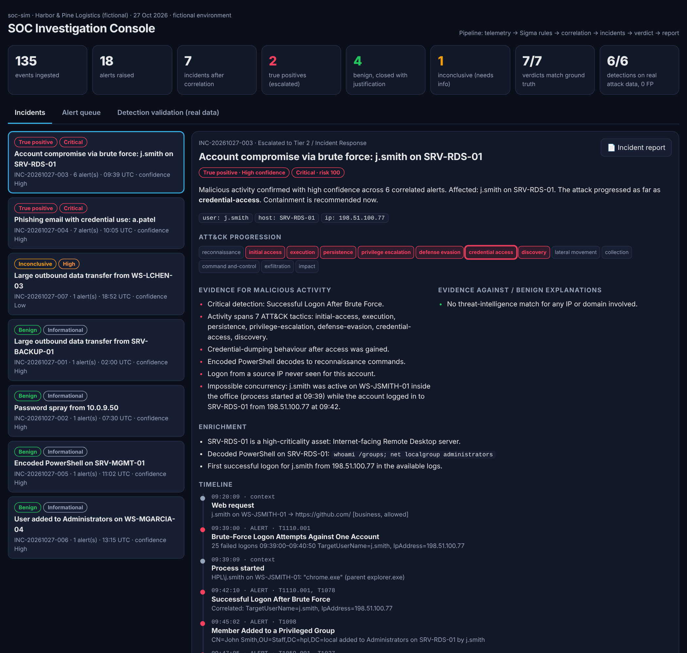
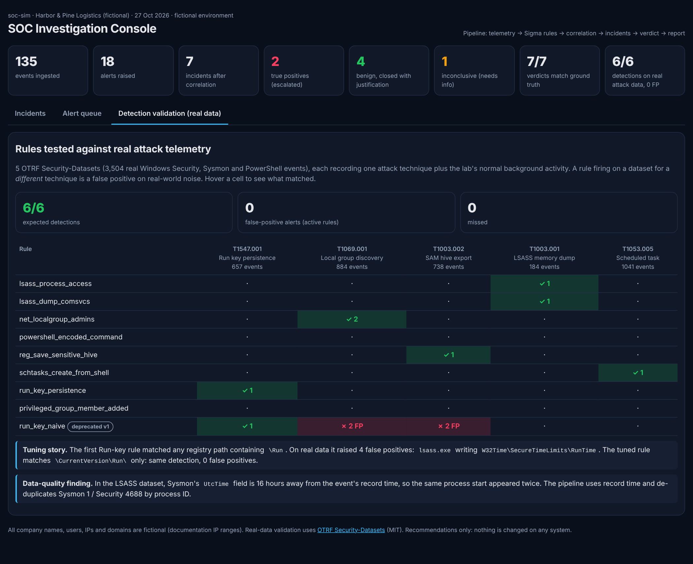

# Project 07 — SOC Investigation & Response Simulator (soc-sim)

A miniature Security Operations Center, from raw logs to a signed-off incident report:

```
telemetry ─► Sigma rules ─► correlation rules ─► entity grouping ─► context & enrichment ─► verdict ─► incident report
```

Most SOC portfolio projects stop when an alert fires. That's where a Tier 1
analyst's job **starts**: is it real, what else happened, what does it mean,
and what should we do? soc-sim automates that investigation workflow and
shows its reasoning at every step. It is tested two ways so the results can't be self-fulfilling:

1. **Against real attack telemetry I didn't write**: 3,504 Windows events from [OTRF Security-Datasets](https://github.com/OTRF/Security-Datasets).
2. **Against a labelled day at a fictional company**, including deliberate false-positive traps that a good analyst must close as benign.



## Results

| Test | Result |
|---|---|
| Rules on **real attack telemetry** (5 OTRF datasets, 3,504 events) | **6/6** expected detections, **0** false positives, **0** missed |
| Rule tuning on real data | Naive Run-key rule: **4 false positives** → tuned rule: **0** |
| Scenario day (135 events) | **18 alerts → 7 incidents** after correlation |
| Incident verdicts vs ground truth | **7/7 correct**: 2 true positives, 4 benign, 1 inconclusive |
| Alerts on benign activity | 5, all closed with a documented reason or held for information. None escalated as an attack. |

## The 7 incidents

| Incident | Verdict | Why |
|---|---|---|
| Account compromise via RDP brute force (j.smith) | 🔴 **True positive**, high | 25 failed logons → success from the same IP → added self to Administrators → encoded PowerShell decoding to `whoami /groups` → SAM hive export. Plus **impossible concurrency**: the real j.smith was using Chrome on their office PC at 09:39 while the account logged in from outside at 09:42. |
| Phishing with credential use (a.patel) | 🔴 **True positive**, high | Email scored 100 by Project 02's analyzer → click on a domain from Project 03's threat-intel IOCs → logon from a known attacker IP. **Scope:** 2 people received it; only a.patel clicked. |
| Encoded PowerShell on the IT management server | 🟢 Benign | Matches approved change CHG-1042 (host, account, rule and time window), and the decoded script only reads service status. |
| User added to Administrators on a workstation | 🟢 Benign | Approved change CHG-2231, performed by the helpdesk inside the window. Contrast with the attacker who did the same thing with no ticket. |
| 42 GB transfer from the backup server | 🟢 Benign | Known backup route to the off-site provider. |
| Password spray from 10.0.9.50 | 🟢 Benign | The authorised vulnerability scanner; recommends a suppression so it stops paging the SOC weekly. |
| 3.4 GB evening upload with rclone (l.chen) | 🟠 **Inconclusive** | rclone is a legitimate tool that is also widely abused for data theft. It was run interactively by the user, there's no threat-intel match and nothing came before it. The honest answer is "ask the user's manager", so it lists the open questions instead of guessing. |

The S6 case is deliberate. A tool that labels everything an attack is easy
to build. Knowing when the evidence isn't enough is the actual job.

## What makes it different

### 1. Detections are tested on real data, not just data I wrote

Each OTRF dataset records one real attack technique **plus the lab machine's
normal background noise**: Wireshark, a monitoring agent, the Windows search
indexer, LSASS housekeeping. A rule that fires on a dataset recording a *different*
technique is a false positive on real-world noise.



**A real tuning story.** My first Run-key persistence rule matched any
registry path containing `\Run`. On real data it raised 4 false positives:
`lsass.exe` writing `W32Time\SecureTimeLimits\RunTime\...`. The tuned rule
matches `\CurrentVersion\Run\` and `\RunOnce\` only, giving the same detection and 0 false
positives. Both versions are kept (`rules/deprecated/`) so the improvement is visible.

**A real data-quality finding.** In the LSASS dataset the same process start
appeared twice, 16 hours apart. Sysmon's own `UtcTime` field disagrees with the
event's record time. The pipeline uses the record time and de-duplicates
Sysmon event 1 and Security event 4688 by process ID (Sysmon logs it in decimal,
4688 in hex). Messy timestamps across log sources are an everyday SIEM problem.

### 2. Standard rule formats

- **Detection rules are Sigma YAML** (`rules/detection/`), so they can be converted
  to Splunk SPL or Microsoft Sentinel KQL with the official pySigma tooling.
- **Correlation rules follow the Sigma correlation specification** (`rules/correlation/`):
  `event_count` (brute force), `value_count` (password spray) and `temporal_ordered`
  (brute force *followed by* a successful logon). Correlations can chain.
- The engine (`soc/sigma.py`) implements the Sigma features these rules use:
  logsource matching, field modifiers (`contains`, `startswith`, `endswith`, `all`,
  `re`, `cidr`, `windash`, `gt`/`gte`/`lt`/`lte`), wildcards and full condition expressions
  (`and`/`or`/`not`, `1 of sel_*`, `all of them`).

### 3. Correlation by entity, not just by time

Alerts that share an entity (user, host, IP, email sender, malicious domain)
within two hours become one incident. That's the idea behind risk-based alerting in
Splunk ES and incidents in Microsoft Sentinel. Correlation alerts link only
through their group-by fields, so a password spray across 12 accounts doesn't
merge 12 unrelated users into one incident.

### 4. Context, enrichment and honest verdicts

| Step | What it does |
|---|---|
| Threat intel | IPs and domains matched against an IOC list in Project 03's format |
| Decoding | `-EncodedCommand` PowerShell decoded (Base64 / UTF-16LE) and checked for reconnaissance commands |
| Asset context | Criticality and role of each host (internet-facing RDS, domain controller…) |
| Change tickets | An alert is explained only if host, actor, rule **and** time window all match an approved change |
| Allowlists | Authorised scanner IPs, known backup routes |
| Related events | Pulls the non-alert events around each incident (what the user was doing, which process made a transfer) |
| Behavioural checks | First logon from a new IP, activity outside business hours, impossible concurrency, dual-use tools |

Every incident gets a verdict (**True positive / Benign / Inconclusive**), a
confidence level, the evidence **for** and **against**, the furthest ATT&CK
stage reached, open questions, and phased recommendations (contain → eradicate
→ recover → follow up). The verdict logic never reads the ground-truth labels;
they are used only by the evaluator afterwards.

### 5. An analyst console and real reports

- `output/soc_console.html`: one offline HTML file with the incident queue, timeline,
  ATT&CK progression, evidence and actions, the alert queue, and the real-data validation matrix.
  Each incident's report can be viewed, copied or downloaded.
- `output/reports/INC-*.md`: incident reports ready to hand to Tier 2:
  executive summary, timeline, ATT&CK mapping, analysis, conclusion with
  confidence, uncertainties, IOCs and recommended actions. Example:
  [INC-20261027-003](output/reports/INC-20261027-003.md).

## Quick start

```bash
pip install -r requirements.txt            # only dependency: PyYAML (for Sigma rules)
python3 soc_sim.py all                     # validate on real data + investigate scenarios + build console
python3 soc_sim.py validate                # real-data validation only
python3 soc_sim.py run                     # scenario investigation only
python3 soc_sim.py rules                   # list rules with ATT&CK mapping
python3 -m unittest discover -s tests -v   # 21 tests
open output/soc_console.html
```

`soc_sim.py all` exits non-zero if any verdict is wrong or any active rule
misses or false-positives on the real data, so CI catches regressions.

## Repository layout

```
soc/sigma.py        Sigma rule engine          soc/detect.py     detection + Sigma correlation engine
soc/events.py       loading + field pipeline   soc/incidents.py  grouping, context, enrichment, verdicts
soc/validate.py     real-data validation       soc/evaluate.py   scoring against ground truth
soc/report.py       incident reports           soc/console.py    interactive console
rules/              14 detection + 3 correlation rules (+1 deprecated, kept for the tuning story)
datasets/otrf/      5 real OTRF datasets (MIT licence, see LICENSE-OTRF)
datasets/scenarios/ fictional company day: build script, events, labels, context, threat intel
```

## Limitations

- **The scenario day is authored**, so its results show the workflow and judgement
  rather than detection accuracy. Detection accuracy is what the real OTRF data tests.
- The OTRF datasets are atomic (one technique each). They test rules against real
  noise, but not against a full attack chain in real data.
- Five real datasets is a small sample. Adding more (for example OTRF's compound
  "APT29" datasets) is the obvious next step.
- The verdict scoring is rule-based and transparent by design. Real SOCs combine
  this with analyst judgement, and the report says "analyst review required".
- Implements the subset of Sigma used by these rules, not the full specification.

## How it connects to the rest of my portfolio

| Project | Used here |
|---|---|
| [01 — AD Detection Lab](../project-01-enterprise-ad-detection-lab/) | Same Windows event types (4625, 4624, 4732, 4688, Sysmon); this project is what happens *after* those alerts fire |
| [02 — Phishing Analyzer](../project-02-phishing-email-analyzer/) | Its risk score drives the phishing detection |
| [03 — IOC Extractor](../project-03-ioc-extractor/) | Its IOC list is the threat-intel feed |
| [04](../project-04-iam-policy-analyzer/) / [06](../project-06-attack-path-analyzer/) | Same ATT&CK-mapped, evidence-first reporting style |

## Credits

Real telemetry: [OTRF Security-Datasets](https://github.com/OTRF/Security-Datasets) by the
Open Threat Research Forge (MIT licence). Rule format: [Sigma](https://sigmahq.io).
Techniques: [MITRE ATT&CK](https://attack.mitre.org).
